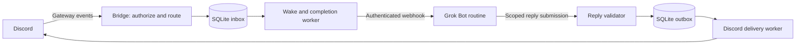

# Architecture

Status: local, single-owner Grok Bot routine topology selected. The text runtime and helper are implemented and tested offline; live integration and Linux service installation remain unverified.

## Deployment and components

Start with one private server, one authorized human, one channel, and one Grok Bot. Use Python with discord.py, an HTTP client/server library, and standard-library SQLite. Lock dependencies and ship one service. No separate queue infrastructure is needed at this scale.

The inbox, outbox, and request states share one database. Persist the request before showing “Queued.” Persist the reply before acknowledging its submission. The destination comes only from stored Discord event metadata.

The selected deployment runs beside Grok using an authenticated loopback API and a terminal helper. The Docker path isolates service credentials/state in a named volume and gives Grok a host helper with a separate credential. The optional native Linux installer uses a dedicated OS account. Remote runtime/callback support is outside v1.

## Minimal setup target

1. Create a Discord application, copy its bot token, and invite it to the private server with View Channel, Send Messages, and Read Message History only. Give access only to configured channels. Threads require separate explicit permissions if supported later.
2. Run a setup wizard: hidden token/key input, choose guild/channel/owner IDs, supply Grok webhook details, select Docker or native local deployment. Generate bridge authentication credentials automatically and save private files.
3. Create one Grok webhook routine from the supplied adapter instructions. Run an actual round-trip check before reporting setup complete, then start the managed service.

Use direct bot mentions initially. Discord makes mentioned-message content available without the privileged Message Content Intent. This avoids enabling broad message-content access and removes alias/role routing from the first setup. [Discord intent exceptions](https://docs.discord.com/developers/events/gateway#message-content-intent)

The implemented commands are `bridge setup`, `bridge doctor`, `bridge run`, `bridge claim`, `bridge reply`, `bridge status`, `bridge recover`, and `bridge mock`. Doctor checks readiness; the real final-reply smoke test remains a separate manual step.

## Grok integration contract

The webhook wakes a routine; HTTP success is not completion. Test whether webhook bodies reach the routine and whether repeat wakes create concurrent tasks. If the body is unavailable, the routine must claim the durable job through the authenticated helper/API rather than rely on a mutable “last message” file.

A claim returns a versioned event with stable `event_id`, opaque `conversation_id`, input snapshot, sequence, attempt generation, and an expiring reply capability. The routine submits `event_id`, generation, capability, response ID, text, and final/no-reply disposition. It supplies no channel, guild, URL, or arbitrary destination.

Persist the first accepted final response and its content hash. An exact replay returns the original receipt; a conflicting final response is rejected. Use a single final response in v1; streaming/progress events require a separately specified ordered protocol.

The routine must durably deduplicate events and return a cached outcome on replay if Grok can do so. Without that support, the bridge can suppress duplicate visible replies but cannot guarantee that Grok tools execute once. Do not blindly re-wake tasks that may perform side effects after an ambiguous timeout; mark them as requiring reconciliation.

## Consistency contract

| Property | Required behavior |
| --- | --- |
| Identity | One inbox record per Discord message ID, surviving restarts |
| Admission | A message is accepted only after transaction commit; queue limits produce an explicit rejection |
| Context | Stable conversation mapping, scoped by server/channel or thread/bot; no accidental cross-channel history |
| Order | One active request per conversation, in persisted acceptance order; unrelated conversations can progress independently |
| Completion | Dispatch success, agent completion, and Discord delivery are separate recorded states |
| Retry | Lease and attempt generation prevent stale workers/callbacks from overwriting current work |
| Reply routing | Only the recorded originating channel/message; recheck current allowlists before delivery |
| Output | Persistent response and chunk IDs; checkpoint each confirmed Discord message ID |
| Failure | Explicit expired, failed, or uncertain states, with a safe recovery command |

Implemented lifecycle: `queued → waking → awaiting → claimed → reply → delivered`. A helper may claim before the wake returns. `failed` and `uncertain` are alternatives; expiry creates a recorded failure notice in the `reply` state. Status preserves the error category after that notice is delivered. Persist transitions atomically. A fast callback can arrive before the wake response; its accepted final state must never be overwritten by the wake worker.

Do not let a later request overtake an unresolved earlier request in the same conversation. Expiry releases capacity after recording the outcome; it does not silently delete the request. Reject expired capabilities and outdated generations. Record no-reply completion explicitly so an intentionally silent task cannot block the queue indefinitely.

Persist text as received, without silent whitespace stripping. Treat message edits/deletes as separate policy decisions: v1 snapshots the accepted text and does not rerun edits. Do not splice separate authors' inputs into one agent conversation without a defined shared-context policy.

## Limits on guarantees

Durability covers accepted events, not every event Discord ever creates. Gateway reconnect/resume helps during short interruptions; a process offline past the resumable session needs bounded history catch-up with a persisted watermark. Catch-up must coordinate with live events, deduplicate, and detect incomplete scans. Messages deleted before recovery may be unrecoverable. Never claim “no lost messages” without this boundary.

Discord supports `nonce` with `enforce_nonce` to suppress duplicate creates only within the recent few minutes. Persist a deterministic nonce per output chunk and use it for short retries. A crash after Discord accepts a message but before the database commits its ID remains an ambiguity outside that window. Stop and reconcile rather than blindly retry indefinitely. [Discord create-message contract](https://docs.discord.com/developers/resources/message#create-message)

Model memory is a different issue: a stable bridge conversation ID does not establish that Grok preserves or shares chat history. Verify the runtime's actual session behavior; otherwise supply explicit bounded history or document independent routine contexts. Shared history with the native Grok chat needs backend support.
